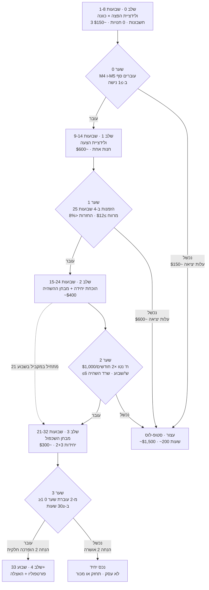

# 02 — חמישה שלבים, שערים, עלויות יציאה ותקציב זמן

## מפת השלבים

**שים לב לחפיפה:** שלב 3 מתחיל בשבוע 21, לפני ששער 2 נסגר. זה מכוון.
המידע היקר ביותר הוא "כמה עולה היחידה השנייה", ואין סיבה לחכות לו עוד
חודשיים. העלות של ההקדמה היא ~15 שעות שאולי יתבזבזו; התועלת היא ורדיקט
מוקדם ב-11 שבועות על השאלה שקובעת הכל.

---

## שלב 0 — ולידציית הפצה × כוונה

**שבועות 1–8 · 8 ש'/שבוע · 64 שעות · $80–180**

הפרוטוקול המלא ב-[`03-phase0-experiment.md`](03-phase0-experiment.md).
כאן רק המסגרת.

| | |
|---|---|
| **מה נבנה** | 3 חשבונות IG עסקיים בשלוש נישות · 40 רילים לחשבון · דף המתנה חינמי (Carrd/Beacons) · ManyChat בשכבה החינמית |
| **מה **לא** נבנה** | חנות · חשבון Shopify · חשבון ספק · חשבון סליקה · דומיין בתשלום · ישות משפטית |
| **הוצאה** | כלי AI לווידאו/קול (~$40–60/חודש × 2 חודשים) · דומיין לדף המתנה $12 (אופציונלי) |
| **מדד ראשי** | ביקורי פרופיל ל-1,000 צפיות (M4) והקשות לינק ל-1,000 צפיות (M5) |
| **מדד משני** | יחס החזקה (M1) · שיתופים ל-1,000 (M2) · % רילים מעל 5,000 צפיות (M3) |

### שער 0 — תנאי מעבר

נישה עוברת אם **כל** התנאים מתקיימים עליה:

| # | תנאי | סף | למה זה הסף |
|---|---|---|---|
| G0.1 | ביקורי פרופיל / 1,000 צפיות | **≥ 8** | מתחת לזה — הצופים לא סקרנים לגבי המקור. אין משפך. |
| G0.2 | הקשות לינק / 1,000 צפיות (ביו + DM) | **≥ 2** | הרצפה שמתחתיה גם היט של 500K לא מייצר 1,000 סשנים. |
| G0.3 | הרשמות לרשימת המתנה / הקשות לינק | **≥ 10%** | מבחין בין "סקרן" ל"רוצה". |
| G0.4 | לפחות אחד מ: יחס החזקה חציוני ≥0.50 **או** שיתופים/1,000 ≥5 | — | מוודא שלא נכשלת בגלל תוכן חלש שאפשר לתקן, מול נישה שהיא באמת מתה. |
| G0.5 | החשבון לא הוסר מהמלצות | בינארי | ראה סעיף "בדיקת בריאות" למטה. |

**מצב ביניים אחד ויחיד:** אם G0.1 עובר אבל G0.2 נכשל — זו בעיית CTA,
לא בעיית נישה. מותרת הארכה של 3 שבועות עם CTA חדש, **פעם אחת בלבד,
ולנישה אחת בלבד**. כל מצב אחר: כישלון.

**אם אף נישה לא עוברת:** לא מנסים נישה רביעית. עוצרים. שלוש דגימות
עצמאיות שנכשלו על מדד עם שונות נמוכה הן ראיה חזקה מספיק.

### עלות יציאה משלב 0

**~$150 מזומן, ~64 שעות.** אין מה לפרק: מבטלים 2–3 מנויי כלי AI, משאירים
את החשבונות באוויר. אין ספק, אין מלאי, אין התחייבות, אין חשיפה משפטית.
**זה השער הכי זול שתפגוש. אל תדלג עליו ואל תקצר אותו.**

### בדיקה מול האילוץ

8 ש'/שבוע = 5 ש' ייצור תוכן (15 רילים × ~18 דק') + 2 ש' ניתוח + 1 ש'
תחזוקה. **עמידות בהשהיה: גבוהה** — יש מאגר מתוזמן מראש, אפשר להיעדר
שבועיים בלי נזק. פירוט מלא ב-[`05-operations.md`](05-operations.md).

---

## שלב 1 — ולידציית הצעה

**שבועות 9–14 · 8 ש'/שבוע ממוצע (שבוע בנייה: 13 ש') · 51 שעות · $400–700**

| | |
|---|---|
| **מה נבנה** | חנות מוצר-יחיד לנישה המנצחת · חשבון ספק CJ/Zendrop **עם מחסן אמריקאי** · סליקה · הלפדסק · אוטומציית DM מלאה · 3 מיילים אוטומטיים |
| **החלטת מפתח בשלב** | ישות ישראלית + סולק צד-שלישי **מול** LLC אמריקאית + Shopify Payments. ראה [`06-risks.md`](06-risks.md) §2 להשוואה מספרית. |
| **הזמנת דגימה** | חובה. מזמין לעצמך, מודד זמן אספקה אמיתי, מצלם, בודק איכות. $40 + 6–12 ימים. |
| **הוצאה** | Shopify (נצל trial של $1 לחודשיים-שלושה) · דומיין $12 · אפליקציות ~$30/ח' · דגימה $40 · ייעוץ רו"ח ראשוני $200–400 |

### שער 1 — תנאי מעבר

נמדד על **4 שבועות רצופים** של מכירה פעילה (שבועות 11–14):

| # | תנאי | סף | הערה |
|---|---|---|---|
| G1.1 | הזמנות משולמות | **≥ 25** | מתחת ל-25 אין שום מובהקות ל-CVR ולשיעור החזרות. |
| G1.2 | תרומה שולית להזמנה | **≥ $12** | אחרי COGS, משלוח, מכס, סליקה. לא כולל עלויות קבועות. |
| G1.3 | שיעור החזרות/ביטולים | **< 8%** | מעל זה — בעיית מוצר או בעיית ציפיות. |
| G1.4 | חציון זמן אספקה בפועל | **< 18 ימים** | נמדד מהזמנה ועד "נמסר" בטראקינג, לא הבטחת הספק. |
| G1.5 | צ'ארג'בקים | **0** על 25 הזמנות | הראשון שמופיע הוא אזהרה, לא כישלון — אבל תעצור ותבין למה. |
| G1.6 | אין הקפאה/רזרבה אצל הסולק | בינארי | ראה סיכון R2. |

### עלות יציאה משלב 1

**~$600 מצטבר, ~115 שעות מצטבר.** מה שצריך לפרק: ביטול Shopify (בכל רגע,
ללא קנס), ביטול אפליקציות, סגירת חשבון ספק (ללא התחייבות), ביטול הדומיין
בחידוש. **נשארת עם:** דומיין, נכס תוכן, וידע על ספק. אין מלאי תקוע — זו
התכונה שהצדיקה דרופשיפינג מלכתחילה.

### בדיקה מול האילוץ — **כאן החריגה היחידה**

שבוע 9 (בניית החנות) דורש **13 שעות**. זו החריגה היחידה מתקציב ה-6–10
בכל התוכנית. **תזמן אותו לשבוע עבודה שאתה יודע מראש שהוא רגוע**, או פצל
אותו לשני שבועות של 9 ש'. אל "תדחוף" אותו — שבוע של 13 שעות אחרי שבוע
עבודה של 60 שעות הוא בדיוק המקום שבו פרויקטי צד מתים.

מרגע שהחנות באוויר: **עמידות בהשהיה: בינונית.** שירות לקוחות הוא ההתחייבות
היחידה שלא ניתנת לדחייה מעבר ל-48 שעות. הפתרון בקובץ 05.

---

## שלב 2 — הוכחת יחידה + מבחן ההשהיה

**שבועות 15–24 · 7 ש'/שבוע · 70 שעות · $300–500**

מטרת השלב היא **לא** לגדול. היא לענות על שתי שאלות: האם היחידה מייצרת
תזרים משמעותי, והאם היא שורדת בלעדיך.

| | |
|---|---|
| **מה עושים** | אופטימיזציה של המשפך (לא של נפח התוכן): DM flow, באנדל/אפסייל, מיילי עגלה נטושה, שיפור דף המוצר. הוקים מנצחים משלב 0 מקבלים משקל. |
| **מה לא עושים** | לא מוסיפים SKU-ים · לא פותחים חשבון שני לאותה נישה · לא מתחילים פרסום ממומן |

### מבחן ההשהיה — הגייט שמתרגם את האילוץ שלך למספר

בשבועות 21–22 (שבועיים רצופים) **אתה מפסיק לפרסם בכוונה.** בלי מאגר
מתוזמן, בלי שום פעילות פרט לשירות לקוחות. זה לא תרגיל — זו הסימולציה של
רבעון סגירה בעבודה, של מילואים, של חופשה, של שפעת.

מודדים: צפיות שבועיות, סשנים והזמנות בשבועות 23–24 מול הבסיס של 19–20.

**סף: דעיכה של פחות מ-40% בהזמנות שבועיות.** אם היחידה מאבדת יותר מ-40%
משבועיים של שקט, היא לא נכס — היא עבודה שנייה שמשלמת גרוע. עדיף לדעת
את זה בשבוע 24 מאשר בשבוע 60.

### שער 2 — תנאי מעבר

| # | תנאי | סף |
|---|---|---|
| G2.1 | תרומה נטו חודשית (אחרי כל העלויות הקבועות) | **≥ $1,000** בשני חודשים רצופים |
| G2.2 | זמן אישי בפועל | **≤ 6 ש'/שבוע** ממוצע על 4 שבועות |
| G2.3 | מבחן ההשהיה | דעיכה **< 40%** |
| G2.4 | צ'ארג'בקים מצטברים | **< 0.5%** מההזמנות |
| G2.5 | מדיניות שהוגדרה: החזרות, משלוח, פרטיות | קיימת ומפורסמת |

**עלות יציאה:** ~$1,100 מצטבר, ~185 שעות. אותו פירוק כמו שלב 1.

---

## שלב 3 — מבחן השכפול · **השער היחיד שקובע אם זה עסק**

**שבועות 21–32 (חופף לשלב 2) · +4 ש'/שבוע · ~48 שעות · $200–350**

מריצים את פרוטוקול שלב 0 **בדיוק כפי שהוא**, על שתי נישות חדשות, עם
הפלייבוק שנכתב תוך כדי שלבים 0–2. אותם 10 הוקים, אותם ספים, אותן מטריקות.
**חשבונות חדשים לגמרי — שום קרוס-פרומושן מהחשבון הקיים.** קרוס-פרומושן
היה מזהם את הניסוי בדיוק בהנחה שאתה בודק.

### שער 3 — תנאי מעבר

| # | תנאי | סף | מה זה אומר |
|---|---|---|---|
| G3.1 | לפחות 1 מ-2 היחידות החדשות עוברת שער 0 | ≥1 | ההפצה ניתנת לשחזור ברמת התהליך |
| G3.2 | שעות עד שער 0 ליחידה חדשה | **≤ 30 שעות** (מול 64 ביחידה הראשונה) | הידע עובר. יש עקומת למידה. |
| G3.3 | ההוקים המנצחים משלב 0 מנצחים גם בנישה החדשה | ≥2 מ-3 | הידע הוא כללי ולא ספציפי-נישה |

### מה קורה בכל תוצאה — **תכתוב את זה עכשיו, לא אז**

**עובר:** הנחה 2 הופרכה חלקית. יש עסק. עוברים לשלב 4, וכל יחידה חדשה
שווה ~$37/שעה בתוחלת עם זנב פתוח.

**נכשל (אף אחת לא עוברת, או שהיא עוברת אבל עלתה 60+ שעות):** **הנחה 2
אושרה, ואין פורטפוליו.** יש לך נכס יחיד. שתי אפשרויות לגיטימיות:
1. תחזק אותו כנכס פסיבי במינימום שעות (אם עבר את מבחן ההשהיה, זה סביר)
2. מכור אותו (Flippa/Empire Flippers, מכפיל טיפוסי 20–30× רווח חודשי
   לנכס בגודל הזה — יחידה ב-$1,000/ח' שווה $20,000–30,000, וזה מספר
   שמצדיק רטרואקטיבית את כל 200 השעות)

**מה שאסור:** להמשיך לשלב 4 בכל זאת "כי היחידה הראשונה עובדת". שער 3
נכשל = הסקייל לא קיים, והשעה השלישית שלך תעלה כמו הראשונה.

---

## שלב 4 — פורטפוליו והאצלה

**שבוע 33+ · 10 ש'/שבוע · $500–1,500/חודש הוצאות**

נכנסים לכאן רק אחרי שער 3.

| | |
|---|---|
| **מבנה יעד** | 5–8 יחידות פעילות. מניחים כשל של ~60% — כלומר ~2–3 יחידות מייצרות תזרים בכל רגע נתון. |
| **האצלה** | עורך וידאו/VA לייצור תוכן ($400–800/ח' ליחידה), נשארת עם בחירת הוקים, אישור ותמחור |
| **ספק פרטי** | NicheDropshipping/HyperSKU ברמת 300 הזמנות למוצר לרבעון. חוסך ~$2–4 ליחידה + מיתוג + זמני אספקה |
| **סיכון חדש שנכנס כאן** | ריכוזיות פלטפורמה. 8 חשבונות תחת Meta = נקודת כשל אחת. שלב 4 חייב לכלול הפצה במקביל ל-TikTok/YouTube Shorts. |

### שער 4

| # | תנאי | סף |
|---|---|---|
| G4.1 | תרומה נטו כוללת | ≥ $4,000/חודש |
| G4.2 | זמן אישי | ≤ 10 ש'/שבוע |
| G4.3 | ריכוזיות | אף יחידה בודדת אינה >50% מהתזרים |
| G4.4 | תלות בפלטפורמה | ≥25% מהתנועה ממקור שאינו Instagram |

---

## סיכום תקציב הזמן והכסף

| שלב | שבועות | ש'/שבוע | שעות מצטבר | מזומן בשלב | מזומן מצטבר | עמידות בהשהיה |
|---|---|---|---|---|---|---|
| 0 | 1–8 | 8 | 64 | $80–180 | ~$150 | 🟢 גבוהה |
| 1 | 9–14 | 8 (שבוע 9: 13) | 115 | $400–700 | ~$600 | 🟡 בינונית |
| 2 | 15–24 | 7 | 185 | $300–500 | ~$1,100 | 🟡 בינונית |
| 3 | 21–32 | +4 (חופף) | 233 | $200–350 | ~$1,400 | 🟢 גבוהה |
| 4 | 33+ | 10 | — | $500–1,500/ח' | — | 🟠 נמוכה ללא האצלה |

**בדיקה מול האילוץ שהצהרת עליו:** ממוצע 7.6 ש'/שבוע על פני 32 שבועות,
בתוך הטווח 6–10 שהגדרת. חריגה יחידה: שבוע 9 (13 שעות). שיא: שבועות
21–24 שבהם שלבים 2 ו-3 חופפים ל-11 ש'/שבוע — **זו נקודת השבירה האמיתית
של התוכנית**, ואם השבועות האלה נופלים על תקופה עמוסה בעבודה, דחה את
תחילת שלב 3 בשלושה שבועות. זה עולה לך שלושה שבועות של מידע, וזה זול
בהרבה מלשרוף את שני השלבים.
